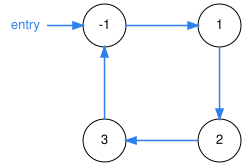
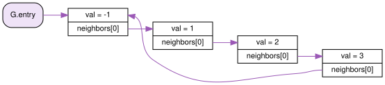
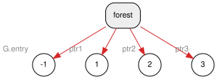
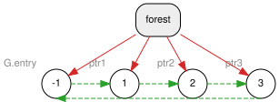
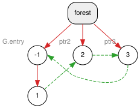
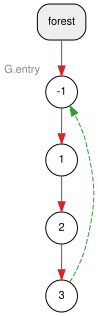
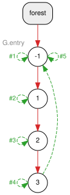

# Example 1: a cyclic graph with `relation_ptr`

Source: [app_example1.cpp](app_example1.cpp)

This example builds a graph with four nodes that form a cycle (`-1 → 1 → 2 → 3 → -1`). With `std::shared_ptr`, a cycle like this would leak. This was the first and original motivating example for cycles project! With `relation_ptr`, every node is freed when the graph goes away, and valgrind reports no leaks.

> **Leak Freedom by Default.** This structure follows the paradigm from Herb Sutter's CppCon 2016 talk [*Leak-Freedom in C++... By Default*](https://www.youtube.com/watch?v=JfmTagWcqoE): the program is leak-free *by construction*. The code never calls `delete` or `collect()`, and it never has to decide which edge of the cycle should be weak. See [Leak Freedom by Default](#leak-freedom-by-default) below.

## The graph

This is the graph we want to represent: four vertices and four directed edges that form a single cycle. The program reaches the graph through an `entry` pointer to vertex `-1`.



Every vertex can be reached from `entry`, but no vertex is "first" or "last": following the edges from any vertex eventually leads back to it. That is exactly what defeats reference counting, as the next section shows.

## First attempt: `std::shared_ptr` (this leaks!)

The most direct implementation uses `std::shared_ptr` for every edge:

```cpp
#include <memory>
#include <vector>

class MyNodeShared {
 public:
  double val;
  std::vector<std::shared_ptr<MyNodeShared>> neighbors;
  explicit MyNodeShared(double val_) : val{val_} {}
};

class MyGraphShared {
 public:
  std::shared_ptr<MyNodeShared> entry;
};

int main() {
  {
    MyGraphShared G;
    G.entry = std::make_shared<MyNodeShared>(-1.0);
    auto ptr1 = std::make_shared<MyNodeShared>(1.0);
    auto ptr2 = std::make_shared<MyNodeShared>(2.0);
    auto ptr3 = std::make_shared<MyNodeShared>(3.0);

    // cycle: -1 -> 1 -> 2 -> 3 -> -1
    G.entry->neighbors.push_back(ptr1);
    ptr1->neighbors.push_back(ptr2);
    ptr2->neighbors.push_back(ptr3);
    ptr3->neighbors.push_back(G.entry);
  }
  // LEAK: all four nodes are still in memory here
  return 0;
}
```

It compiles, it runs, and the graph works. But at the closing `}`, the four nodes are **never freed**:

- When `G`, `ptr1`, `ptr2` and `ptr3` go out of scope, each node's reference count only drops from 2 to 1.
- The remaining count of each node comes from the previous node in the cycle: `-1` keeps `1` alive, `1` keeps `2`, `2` keeps `3`, and `3` keeps `-1`.
- No count ever reaches 0, so no destructor ever runs. The cycle keeps itself alive, unreachable.

valgrind confirms it:

```
==24215==    definitely lost: 48 bytes in 1 blocks
==24215==    indirectly lost: 208 bytes in 7 blocks
```

The 8 blocks are the four nodes (each `make_shared` allocates the node and its control block together) and the four `neighbors` vector buffers.

The usual fix is to make one edge a `std::weak_ptr`. That works when you know in advance which edge closes the cycle, as in a doubly linked list. In a general graph, edges are added and removed at runtime, so there is no fixed "back edge" to choose. `relation_ptr` makes this choice automatically, as the rest of this example shows.

## The `relation_ptr` version (no leak)

```cpp
class MyNode {
 public:
  double val;
  std::vector<relation_ptr<MyNode>> neighbors;
};

class MyGraph {
 public:
  relation_pool<> pool;        // the pool of data (like gcpp's deferred_heap)
  relation_ptr<MyNode> entry;  // the entry point of the graph
};
```

`main` creates the four nodes with `pool.make<MyNode>(...)`. It links each node to the next with `get_owned`, then drops the local pointers `ptr1`, `ptr2` and `ptr3`. After that, this is the same graph as it is laid out in memory. Each vertex is a `MyNode`, and each edge is a `relation_ptr` stored in `neighbors`:



Every arrow is a `relation_ptr`. Each one also records an *owner*. For example, `ptr1.get_owned(G.entry)` creates a pointer to node `1` that is owned by node `-1`.

## What happens inside: the Dynamic Ownership Forest - DOF

Inside the pool, a *Dynamic Ownership Forest* (DOF) tracks who owns what. In all figures below:


- **Red, solid line:** ownership. This is a strong edge in a tree; the parent keeps the child alive.
- **Green, dashed line:** weak link. It records that a node *could* own another one. It doesn't keep anything alive, but it is a candidate to become a strong edge later.
- **`forest`:** the pool's map of tree roots. It is the only thing that holds the roots alive.

The figures show the real state of the forest, traced from the library at each step.

### Step A: `pool.make` four times

```cpp
G.entry = G.pool.make<MyNode>(-1.0);
relation_ptr<MyNode> ptr1 = G.pool.make<MyNode>(1.0);
relation_ptr<MyNode> ptr2 = G.pool.make<MyNode>(2.0);
relation_ptr<MyNode> ptr3 = G.pool.make<MyNode>(3.0);
```

`pool.make<MyNode>(v)` creates an *unowned* relation. The new node becomes the root of its own tree, so the forest now has four trees with one node each. Each root is held through the forest by one variable: `G.entry`, `ptr1`, `ptr2` or `ptr3` (in gray next to its node). There are no links between the nodes yet.



### Step B: four `get_owned` calls close the cycle

```cpp
G.entry->neighbors.push_back(ptr1.get_owned(G.entry));
ptr1->neighbors.push_back(ptr2.get_owned(ptr1));
ptr2->neighbors.push_back(ptr3.get_owned(ptr2));
ptr3->neighbors.push_back(G.entry.get_owned(ptr3));
```

`get_owned` only adds a **weak** link from the owner to the target. The four trees stay separate. Each root is still held by a local variable (`G.entry`, `ptr1`, `ptr2`, `ptr3`) through the forest.



### Step C: dropping the local pointers promotes weak links

`ptr1.reset()` removes the relation that kept node `1` as a root. Before freeing the node, the forest looks for a new owner among its weak links (`owned_by`). Node `-1` weakly owns `1` and is **not** a descendant of `1`, so the weak link `-1 ⇢ 1` becomes a strong edge. Node `1` moves into the tree of `-1`:



`ptr2.reset()` and `ptr3.reset()` do the same thing: `2` moves under `1`, and `3` moves under `2`. The result is a single tree:



The edge `3 → -1` that closes the cycle **stays weak**. It can't become strong, because `-1` is an ancestor of `3`, and a strong edge there would create an ownership cycle. This is how the library breaks cycles automatically: the strong edges always form trees, and every link that would close a cycle stays weak.

The graph is still fully navigable: `G.entry->neighbors[0]->neighbors[0]->neighbors[0]->neighbors[0]` reaches `-1` again.

### Traversing the graph: `get_self_owned`

Before `G` is destroyed, the end of `main` prints the graph by walking the cycle from `G.entry`:

```cpp
void printFrom(relation_ptr<MyNode> target, const relation_ptr<MyNode>& origin,
               bool isFirst = false) {
  if (!target || !origin) return;
  if (isFirst || (target.get() != origin.get())) {
    std::cout << target.get()->val << " ";

    for (const auto& node : target->neighbors)
      printFrom(node.get_self_owned(), origin);
  }
}

// in main:
printFrom(G.entry.get_self_owned(), G.entry, true);
```

`printFrom` takes `target` **by value**, so each call needs its own `relation_ptr` to the node it visits. Since `relation_ptr` is move-only, it can't be copied, and moving `G.entry` or a `neighbors` entry into the call would take that edge out of the graph. `get_self_owned()` solves this: it creates a **new**, temporary relation to the same node, owned by the node itself, without touching any existing edge.

A self-owned relation is only a weak self-link: the node never keeps itself alive, so the temporary can't change who owns what. The figure below shows the forest at the deepest point of the walk, while five nested calls are alive. Each green self-loop is the `target` of one call, numbered by call (`#1` is the first call, from `main`):



- **Calls `#1` to `#4`** visit `-1`, `1`, `2` and `3`, and each one adds a self-link to the node it visits.
- **Call `#5`** follows `3 → -1` and reaches `-1` again. Since `-1` is the `origin`, it stops without printing. While it is alive, `-1` has two self-links, `#1` and `#5`.
- **The red tree never changes.** The traversal doesn't move or promote any edge.

As each call returns, its `target` is destroyed and only its self-link is removed. When the walk ends, the forest is exactly as it was after Step C3. This was traced from the library, and valgrind reports no leak. The output is `-1 1 2 3`.

### Step D: destruction, with no leak

When `G` goes out of scope, `G.entry` is destroyed first. Members are destroyed in reverse order of declaration. Its relation was the root of the only tree, so the forest again looks for a new owner for `-1`. The only candidate is `3`, but `3` is a **descendant** of `-1`. A node can't be kept alive by its own subtree, so the candidate is rejected. Node `-1` and its whole tree go to the pending list and are freed iteratively (not recursively, so long lists don't overflow the stack). The forest ends up empty.

## Leak Freedom by Default

In [*Leak-Freedom in C++... By Default*](https://www.youtube.com/watch?v=JfmTagWcqoE) (CppCon 2016), Herb Sutter argues that leaks should be prevented by the *types* a program uses, not by programmer discipline or by tools that find leaks afterwards. Pick the right ownership type, and the program can't leak. His ladder of options:

1. Scoped objects and members, when the lifetime fits a scope.
2. `std::unique_ptr` for tree-shaped ownership.
3. `std::shared_ptr` for shared ownership without cycles (DAGs), and `std::weak_ptr` when you know which edge closes a cycle.
4. For arbitrary graphs with cycles, which the standard pointers don't cover, his experimental [gcpp](https://github.com/hsutter/gcpp) library with `deferred_heap` and `deferred_ptr`.

This example sits on rung 4, and it is leak-free by default in that sense:

- **No manual cleanup.** There is no `delete`, no destructor walking the graph, and no call to `collect()`. In gcpp, an unreachable cycle is reclaimed only when a collection runs (an explicit `collect()`, or optionally one before the heap grows) or when the whole `deferred_heap` is destroyed. Here, the cycle is freed as soon as `G.entry` goes away (Step D).
- **No ownership decision left to the programmer.** The `shared_ptr` fix needs someone to pick the weak edge, and to pick it again whenever the graph changes. Here every edge is declared the same way (`get_owned`), and the forest decides which edges are strong and which stay weak (Step C).
- **No accidental shared ownership.** `relation_ptr` is move-only, so it can't be copied by accident. Every new relation to an existing node is created explicitly, and the usual way, `get_owned`, forces the code to name its owner.
- **No stack overflow on teardown.** Nodes are freed iteratively from the pending list, so destroying a long chain doesn't recurse once per node.
- **Checked, not assumed.** Running the example under valgrind reports `All heap blocks were freed -- no leaks are possible`, while the `shared_ptr` version above loses 256 bytes.

As in the talk, this rung is the last resort. `relation_ptr` is slower than `unique_ptr` and `shared_ptr`, so use those whenever the ownership is a tree or a DAG, and keep `relation_ptr` for structures with real cycles.

## Build and run

```bash
cmake --preset debug && cmake --build --preset debug
build/debug/examples/example1
valgrind --leak-check=full build/debug/examples/example1
```

Expected output:

```
printFrom(-1)
-1 1 2 3 finished
```

valgrind reports `All heap blocks were freed -- no leaks are possible`.

Next: [Example 2](app_example2.md) does the same with the self-ownership pattern.
