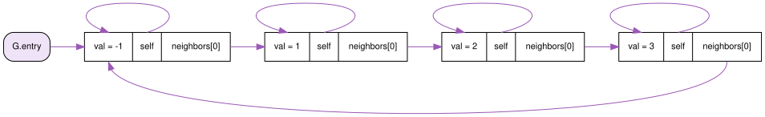
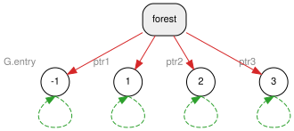
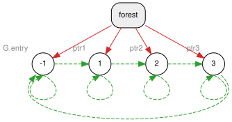
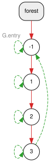

# Example 2: the self-ownership pattern

Source: [app_example2.cpp](app_example2.cpp)

This example builds the same cyclic graph as [Example 1](app_example1.md) (`-1 → 1 → 2 → 3 → -1`). The difference is that every node keeps a relation to **itself**, called `self`. With `self`, a node can create relations owned by itself from inside its own methods, so helpers like `add_neighbor` become easy to write.

## Why `self`?

In Example 1, every edge names its owner at the call site, so the owner appears twice:

```cpp
ptr1->neighbors.push_back(ptr2.get_owned(ptr1));  // ptr1 twice
```

Nothing checks that both are the same node: `ptr1->neighbors.push_back(ptr2.get_owned(ptr3))` compiles, and creates an edge stored in `1` but owned by `3`. The natural fix is a member function, but it can't be written:

```cpp
void add_neighbor(const relation_ptr<MyNode>& node) {
  neighbors.push_back(node.get_owned(/* me? */));  // only 'this' (a raw MyNode*) is available
}
```

`get_owned` needs a `relation_ptr` to the owner, and inside a method the node only has `this`. The fix is to store that missing relation in the node: a `self` member, owned by the node itself.

`self` can't be set in the constructor, because the node's `relation_ptr` doesn't exist yet while the node is being built. So the graph creates nodes through a factory, `make_self_node`, which sets `self` right after `pool.make`. Every node then has a valid `self`, and `add_neighbor` always uses the right owner.

## The data structure

```cpp
class MyNode {
 public:
  relation_ptr<MyNode> self;  // self-ownership pattern
  double val;
  std::vector<relation_ptr<MyNode>> neighbors;

  void add_neighbor(const relation_ptr<MyNode>& node) {
    self->neighbors.push_back(node.get_owned(self));
  }
};

class MyGraph {
 public:
  relation_pool<> pool;
  relation_ptr<MyNode> entry;

  auto make_self_node(double v) -> relation_ptr<MyNode> {
    relation_ptr<MyNode> node = pool.make<MyNode>(v);
    node->self = node.get_owned(node);  // the node owns a relation to itself
    return node;
  }
};
```

After `main` links the nodes with `add_neighbor` and drops `ptr1`, `ptr2` and `ptr3`, the user's program sees this:



## What happens inside: the Dynamic Ownership Forest - DOF

The legend is the same as in Example 1:


### Step A: `make_self_node` four times

```cpp
G.entry = G.make_self_node(-1.0);
relation_ptr<MyNode> ptr1 = G.make_self_node(1.0);
relation_ptr<MyNode> ptr2 = G.make_self_node(2.0);
relation_ptr<MyNode> ptr3 = G.make_self_node(3.0);
```

`pool.make` creates a root, as before. Then `node.get_owned(node)` adds a weak link from the node **to itself**: the dashed loop on each node below. A self-link never keeps a node alive, so it doesn't stop the node from being freed. Apart from the self-links, this is the same state as Step A of Example 1: four one-node trees, each held by one variable.



### Step B: `add_neighbor` four times

`add_neighbor(node)` calls `node.get_owned(self)`, which adds a weak link from this node to `node`. After the four calls there are still four trees. Each one has a weak self-loop, and the weak links form a ring:



### Step C: `ptr1`, `ptr2`, `ptr3` are reset

As in Example 1, each reset makes the forest look for a new owner in `owned_by`. **Self-links are skipped**, because a node can't own itself. The next candidate is the previous node in the ring, which is not a descendant, so it becomes the parent. The result is the same single tree as in Example 1, with the weak self-loops still in place:



The edge `3 ⇢ -1` stays weak, because `-1` is an ancestor of `3`.

### Step D: destruction

When `G.entry` is destroyed, `-1` has two candidate owners: itself, which is skipped, and `3`, which is a descendant and is therefore rejected. Nothing can keep `-1` alive, so the whole tree is freed, and the self-links are freed along with it. There is no leak.

## Build and run

```bash
cmake --preset debug && cmake --build --preset debug
build/debug/examples/example2
valgrind --leak-check=full build/debug/examples/example2
```

Expected output:

```
printFrom(-1)
-1 1 2 3 finished
```

valgrind reports `All heap blocks were freed -- no leaks are possible`.

Next: [Example 3](app_example3.md) uses the same pattern to build a circular doubly linked list.
