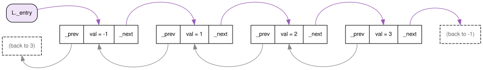
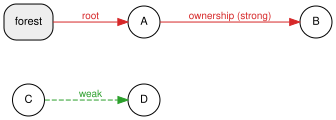
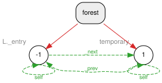
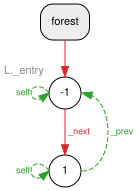
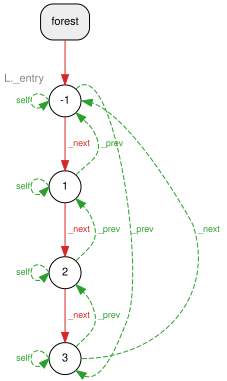

# Example 3: a circular doubly linked list

Source: [app_example3.cpp](app_example3.cpp)

This example builds a circular **doubly** linked list with four nodes (`-1, 1, 2, 3`). Every node points to the next one *and* to the previous one, and the last node points back to the first. A list like this is full of cycles. It uses the self-ownership pattern from [Example 2](app_example2.md), and it doesn't declare a `relation_pool` at all.

## The data structure

```cpp
class MyNode {
 public:
  double val;
 private:
  relation_ptr<MyNode> self;   // self-ownership pattern
  relation_ptr<MyNode> _next;
  relation_ptr<MyNode> _prev;
 public:
  // add node as self->next, and node->prev as self
  void add_next(const relation_ptr<MyNode>& node) {
    self->_next = node.get_owned(self);
    node->_prev = self.get_owned(node);
  }
  // ... next(), prev(), set_next(), set_prev(), set_self()
};

class MyList {
  relation_ptr<MyNode> _entry;  // no pool: the list creates its own forest
  ...
};
```

`main` adds nodes `1`, `2` and `3` with `add_next`, then closes the cycle with `set_next` and `set_prev`. This is what the user's program sees:



`_next` arrows run above the boxes (purple), and the `_prev` back links run below them (gray). The dashed boxes at both ends show where the cycle wraps around: `3._next` points to `-1`, and `-1._prev` points to `3`.

### No `relation_pool`?

`set_entry` creates the forest directly, as a `sptr<DynowForestV1>`, and gives it to the first `relation_ptr`. Every `relation_ptr` keeps a shared reference to its forest, so the forest lives as long as at least one relation uses it. `make_self_node` reuses the same forest through `_entry.get_ctx()`.

## What happens inside: the Dynamic Ownership Forest - DOF

Same legend as before:



In the figures below, each edge is labeled with the field that created it (`_next`, `_prev` or `self`).

### Adding a node: the temporary matters

Look closely at this line:

```cpp
L.entry()->add_next(L.make_self_node(1));
```

`make_self_node(1)` returns a **temporary** `relation_ptr`. While the line runs, that temporary is the root of its own tree. `add_next` adds two weak links: `-1 ⇢ 1` (`_next`) and `1 ⇢ -1` (`_prev`).



At the end of the line, the temporary is destroyed. Node `1` loses its root relation, so the forest looks for a new owner in its `owned_by` list. It skips the self-link and finds `-1` through `_next`. Since `-1` is not a descendant of `1`, that link becomes strong:



The `_prev` link `1 ⇢ -1` stays weak, because `-1` is now an ancestor of `1`.

`L.entry()` and `next()` also create temporaries. They are *self-owned* relations (`get_owned` of a relation to itself), so destroying them doesn't change the trees.

### Closing the cycle

Nodes `2` and `3` are added the same way. Then:

```cpp
L.entry()->next()->next()->next()->set_next(L.entry());  // 3._next = -1
L.entry()->set_prev(L.entry()->next()->next()->next());  // -1._prev = 3
```

These two calls only add weak links. The final forest has one tree, which is exactly the chain of `_next` links. Every `_prev` link, the `_next` that closes the cycle, and the self-links are weak (green, dashed):



This is the same rule as in Examples 1 and 2: strong edges always form a tree, and every link that would close a cycle stays weak.

### Destruction

When `L` goes out of scope, `_entry` is destroyed. Node `-1` has three candidate owners in `owned_by`:
- itself (`self`), which is skipped;
- `1` (through `1._prev`), which is a descendant and is rejected;
- `3` (through `3._next`), which is also a descendant and is rejected.

No candidate can keep `-1` alive, so the whole tree is freed. The last `relation_ptr` that referenced the forest is gone too, so the forest itself is freed.

## Build and run

```bash
cmake --preset debug && cmake --build --preset debug
build/debug/examples/example3
valgrind --leak-check=full build/debug/examples/example3
```

Expected output:

```
printFrom(-1)
-1 1 2 3 finished
```

valgrind reports `All heap blocks were freed -- no leaks are possible`.
